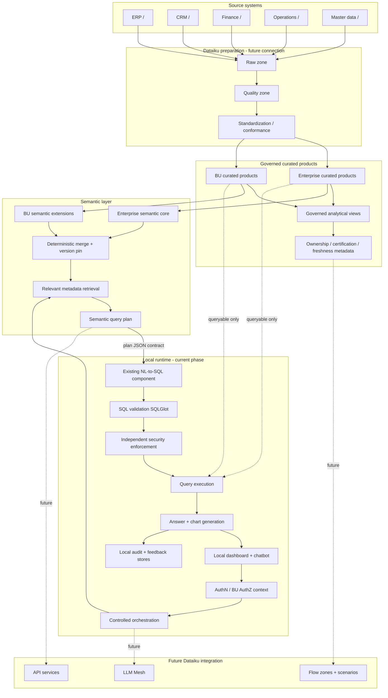
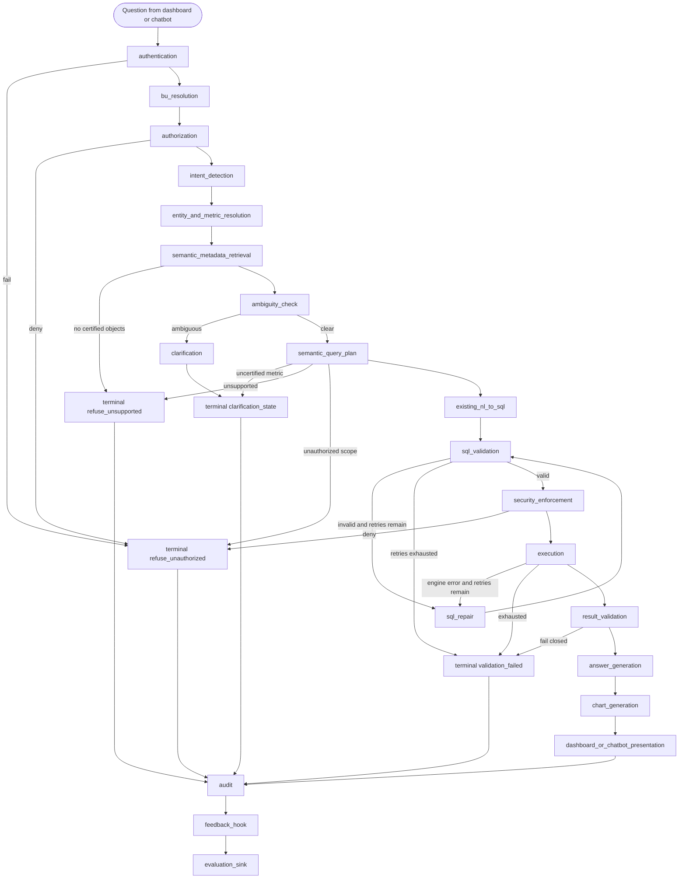
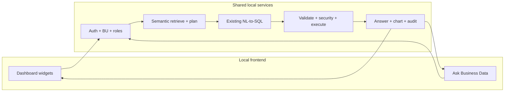

# Enterprise AI-for-BI Architecture (Local-First Design)

**Company:** `<COMPANY_NAME>`  
**Status:** Phase 1 design — documentation only  
**Semantic template version:** `0.2.0`  
**Related:** [semantic_layer.md](semantic_layer.md) · [discovery_questions.md](discovery_questions.md) · [dataiku_flow.md](dataiku_flow.md) · [`semantic/enterprise/enterprise_semantic_model.yaml`](../semantic/enterprise/enterprise_semantic_model.yaml)

This document designs an enterprise natural-language BI experience that answers **broad business questions only over governed, curated data products**. It preserves the **existing local NL-to-SQL implementation**, adds a two-level semantic layer and semantic query plan in front of it, and defines a **local dashboard + chatbot** experience. It does **not** assume Dataiku API Designer, Kubernetes, or cloud hosting for the current phase.

---

## 1. Scope

### In scope for this design phase

1. Enterprise semantic core and BU semantic extensions.
2. Integration **contract** between the semantic layer and the existing NL-to-SQL code.
3. Local frontend dashboard architecture (design only).
4. Local chatbot (“Ask Business Data”) experience (design only).
5. Future integration considerations for Dataiku Flow, LLM Mesh, and API services.
6. Governance, discovery questions, audit, and evaluation design.

### Out of scope for this phase

- Rewriting or replacing the existing NL-to-SQL package.
- Generating LangGraph / SQLGlot / Streamlit / Plotly / recipe / CI implementation code.
- Inventing company-specific KPI formulas.
- Declaring production deployment complete.

---

## 2. Existing-system context (inspected)

| Observation | Status | Implication |
|---|---|---|
| There is **no** top-level `python/` folder in this repository today | Confirmed by inspection | Document target layout `python/` as an **assumption**; map integration to observed `src/nlq/` until NLSQL-01 |
| NL-to-SQL lives under `src/nlq/` (LangGraph, SQL generation, SQLGlot validation, execution, notebooks) | Confirmed | **Do not rebuild**; wrap with semantic planning and frontend contracts |
| Notebooks exist under `notebooks/` (and Dataiku notebook assets under `dataiku/notebooks/`) | Confirmed | Local Jupyter remains a valid development entry until packaging decision |
| Semantic YAML + schema already exist under `semantic/` | Confirmed | This phase deepens design; placeholder enterprise core stays formula-free |
| Optional domain specialization may exist under `semantic/domains/` | Observed | Domain files are **governance-certified specializations**, not a license to invent new KPI math in the enterprise template |
| Local KPI parquet extract observed at design time | Assumed fixture path `<LOCAL_KPI_PARQUET_PATH>` | Shape informs discovery only; curated product certification remains D-01 |
| External GitHub `semantic_layer` URL returned HTTP 404 at design time | Open (GOV-11) | Do not import unverified remote assets |
| All runtime paths currently operate locally | Confirmed | Local frontend + local NL-to-SQL + local semantic files are the Phase 1 operating model |

### Target vs observed layout

```text
# Target packaging assumption (discovery NLSQL-01)
<PROJECT_ROOT>/
├── python/
│   ├── notebooks/
│   ├── nl_to_sql/          # existing NL-to-SQL assets (do not rewrite)
│   └── ...
├── frontend/               # local dashboard + chatbot (design now; code later)
├── docs/
├── semantic/
│   ├── enterprise/
│   ├── business_units/
│   ├── domains/            # optional certified domain cores
│   └── schemas/
├── tests/
└── README.md

# Observed today (must be respected)
<PROJECT_ROOT>/
├── src/nlq/                # existing NL-to-SQL / LangGraph runtime
├── notebooks/
├── frontend/               # not required to exist yet
├── docs/
├── semantic/
└── ...
```

---

## 3. Design principles (locked)

1. Do not query raw or ungoverned tables.
2. The semantic layer is a **business contract** (metrics, grains, joins, security), not table descriptions.
3. Resolve metrics **before** SQL generation.
4. Build an intermediate **semantic query plan**.
5. Retrieve only relevant semantic metadata for the question.
6. Apply security **independently** of the LLM.
7. Clarify rather than guess KPI, BU, period, currency, or unit.
8. Generate answers only from executed and validated results.
9. The chatbot answers supported questions even when the KPI or chart is **not on the dashboard**.
10. Dashboard and chatbot share the same semantic definitions, auth, audit, and curated products.
11. Version metrics, prompts, models, SQL policies, and semantic definitions.
12. Onboard new BUs by configuration, without rewriting NL-to-SQL or agent orchestration.
13. Preserve the existing local NL-to-SQL implementation; integrate through interfaces.
14. Keep the initial dashboard and chatbot local; do not assume production deployment.
15. Use placeholders instead of inventing company-specific details.

---

## 4. Assumptions and constraints

| ID | Assumption / constraint |
|---|---|
| A-01 | `<COMPANY_NAME>` has multiple BUs and shared enterprise metrics plus BU-local metrics. |
| A-02 | Current phase is **local-first**. Dataiku Flow / Mesh / API services are designed for a **future** phase. |
| A-03 | Existing NL-to-SQL already handles basic question→SQL locally and must be reused. |
| A-04 | Semantic planning sits **in front of** NL-to-SQL; NL-to-SQL must not invent metrics or bypass the plan. |
| A-05 | Local auth approach is unresolved (AUTH-01); design supports pluggable identity context. |
| A-06 | Frontend framework is unresolved (FE-01); Streamlit + Plotly are candidates, not commitments. |
| A-07 | BU extensions may add objects; enterprise metric override is forbidden until SM-08. |
| A-08 | Cross-BU comparison is privileged (`can_query_cross_bu`), not default. |
| A-09 | Forecast support is refuse/clarify until B-07. |
| A-10 | No arbitrary Python execution on the query path. Pandas only on row-limited executed results. |
| A-11 | Placeholder enterprise YAML must not contain invented KPI formulas. |
| A-12 | Dashboard KPI card configuration ≠ semantic allowlist. Chatbot may use any authorized certified metric. |

---

## 5. End-to-end architecture



### Layer summary

| Layer | Responsibility | Must not |
|---|---|---|
| Source / raw / quality / std | Land and conform data | Be queried by AI-for-BI |
| Curated products + governed views | Certified grains, owners, freshness | Embed uncertified KPI math that bypasses semantic metrics |
| Semantic layer | Metrics, dimensions, joins, security, versions | Act as a free-text catalog |
| Orchestration | Auth, resolve, plan, clarify/refuse | Guess KPI definitions |
| Existing NL-to-SQL | Compile plan → SQL under allowlists | Invent tables/metrics or skip validation |
| Local frontend | Dashboard + chatbot UX | Become an implicit security boundary |
| Audit / eval | Trace, feedback, golden questions | Store executable secrets in prompts |

---

## 6. Controlled LangGraph workflow

Target control flow (happy path):

**question → authentication → BU resolution → authorization → intent detection → entity/metric resolution → semantic metadata retrieval → ambiguity check → (clarification) → semantic query plan → existing NL-to-SQL → SQL validation → security enforcement → execution → (repair) → result validation → answer → chart → dashboard/chatbot presentation → audit → feedback → evaluation**



### Node classification

| Node | Type | Notes |
|---|---|---|
| authentication, bu_resolution, authorization | Deterministic + security | No LLM trust |
| intent_detection | LLM-assisted | Low temperature; structured slots only |
| entity_and_metric_resolution | Deterministic over semantic model (+ optional LLM ranker) | Cannot invent metric IDs |
| semantic_metadata_retrieval | Deterministic slice | Relevant subgraph only |
| ambiguity_check / clarification | Deterministic decision; LLM may phrase question | Guessing forbidden |
| semantic_query_plan | Deterministic compiler | Plan is the NL-to-SQL input |
| existing_nl_to_sql | Existing component | Boundary preserved |
| sql_validation, security_enforcement | Deterministic security | Independent of prompts |
| execution | Deterministic | Timeout + curated connection |
| sql_repair | LLM-assisted; max 2 | Same validator afterward; never relaxes security |
| result_validation | Deterministic | Freshness / grain / empty / sanity |
| answer_generation | LLM-assisted; result-bound | No world knowledge |
| chart_generation | Rule-based (+ optional type hint) | Bound to executed columns |
| audit / feedback / evaluation | Deterministic sinks | Always on terminal paths |

**Human-approval points (optional, GOV-06):** high-risk cross-BU or sensitive aggregates before presentation.

**Repair limits:** max 2. **Retry limits:** shared with repair counter.  
**Terminal states:** `refuse_unauthorized`, `refuse_unsupported`, `clarification_needed`, `validation_failed`, `execution_failed`, `success`.

---

## 7. Existing NL-to-SQL integration boundary

### Required behavior of the existing component

The existing local NL-to-SQL implementation must eventually satisfy (or be wrapped to satisfy) this **SQL safety contract**. This phase documents the contract; it does not reimplement it.

| Control | Required behavior |
|---|---|
| SELECT only | Reject non-SELECT |
| Single statement | No multi-statement SQL |
| No DDL / DML | No CREATE/ALTER/DROP/INSERT/UPDATE/DELETE/TRUNCATE/MERGE |
| No procedures / arbitrary functions | Block EXEC/CALL and non-allowlisted functions |
| No arbitrary Python | No user code execution on query path |
| Allowlisted DB / schema / products | Only semantic curated products |
| Allowlisted columns | Minus CLS denials |
| Approved joins / relationship paths only | No ad-hoc join graphs |
| RLS + BU filters | Inject or verify predicates from plan/security |
| Sensitive columns | Deny / mask / hash / aggregate-only |
| Row limit + timeout + cost guards | Configurable |
| No raw-table access | Zone discipline |
| No plan bypass | SQL must realize the semantic query plan |
| AST validation | SQLGlot or equivalent deterministic parser |
| Join cardinality validation | Against approved relationship cardinality |
| Cross-BU restrictions | Enforce `can_query_cross_bu` |
| Audit logging | Full request/plan/SQL/status/versions |

### Semantic query plan → NL-to-SQL

Conceptual handoff (not implementation code):

```json
{
  "interface": "semantic_query_plan.v1",
  "plan": {
    "plan_id": "<PLAN_ID>",
    "original_question": "<USER_QUESTION>",
    "rewritten_question": "<REWRITTEN_QUESTION>",
    "authenticated_user": {"user_id": "<USER_ID>", "roles": ["<ROLE_ID>"]},
    "authorized_bu_scope": ["<BU_CODE>"],
    "intent": "trend",
    "metrics": [{"id": "metric.ent.primary_kpi", "version": "0.2.0", "definition_status": "certified"}],
    "dimensions": [{"id": "dim.ent.date"}],
    "entities": [{"id": "ent.primary_event"}],
    "requested_measures": ["<MEASURE_ALIAS>"],
    "time_range": {"grain": "<TIME_GRAIN>", "start": "<START>", "end": "<END>"},
    "fiscal_period": {"calendar_id": "cal.ent.fiscal", "period": "<FISCAL_PERIOD>"},
    "filters": [{"dimension_id": "dim.ent.business_unit", "op": "in", "values": ["<BU_CODE>"]}],
    "ranking": null,
    "comparison": null,
    "variance": null,
    "grouping": ["<TIME_GRAIN>"],
    "sorting": [{"field": "<TIME_GRAIN>", "direction": "asc"}],
    "currency": "<REPORTING_CURRENCY>",
    "unit": "<UNIT_ID>",
    "approved_data_product_ids": ["dp.ent.fact_primary", "dp.ent.dim_calendar"],
    "approved_join_ids": ["join.ent.primary_to_calendar"],
    "row_level_security_predicates": ["<RLS_PREDICATE>"],
    "sensitive_column_restrictions": [],
    "row_limit": 500,
    "expected_output_grain": "<OUTPUT_GRAIN>",
    "expected_result_schema": [{"name": "<COL>", "type": "<TYPE>"}],
    "visualization_intent": "line",
    "ambiguities": [],
    "clarification_required": false,
    "unsupported_reason": null,
    "unauthorized_reason": null,
    "semantic_version": "0.2.0",
    "prompt_bundle_version": "prompts.ent.core.0.1.0"
  },
  "expected_nl_to_sql_output": {
    "sql_query": "<SELECT_ONLY_SQL>",
    "datasets_used": ["<CURATED_PRIMARY_FACT_DATASET>"],
    "columns_used": ["<COL>"],
    "warnings": [],
    "error": null
  }
}
```

**Adapter rule:** If the existing entrypoint today accepts a free-text question + catalog, a thin adapter (future phase) must translate the plan into that entrypoint’s inputs **without** dropping allowlists, joins, or security predicates. The adapter must not invent missing metric definitions.

Observed local entrypoints to review (not rewrite now): `NLQRunner.run`, `ask_nlq`, recipe/batch callers. Exact IO schemas remain discovery items NLSQL-02…NLSQL-06.

---

## 8. Local frontend architecture

### 8.1 Dashboard experience

The local BI dashboard is a **configuration-driven** view over the same semantic model used by the chatbot.

| Area | Behavior |
|---|---|
| Global navigation | Enterprise overview, BU overview, Ask Business Data |
| KPI cards | Enterprise + BU cards from **dashboard config**, filtered by authorization |
| Trend / comparison / variance / target / ranking / drill-down | Bound to certified metrics and approved dimensions |
| Filters | BU, date, fiscal period, currency, unit |
| Freshness | Per data-product SLA indicator |
| Metric definition tooltip | From semantic metric description + version |
| Lineage panel | Data-product ids, owners, certification status |
| Security-aware views | Hide unauthorized cards; never leak denied columns |
| Export | Only if role permits; still subject to row limits |
| Feedback | Per widget + per request_id |

**Critical rule:** Absence of a KPI card does **not** mean the metric is unavailable to the chatbot.

### 8.2 Chatbot experience (“Ask Business Data”)

| Capability | Requirement |
|---|---|
| Placement | Persistent panel + standalone page |
| Independence | Works without relying on currently rendered widgets |
| Suggested questions | From semantic `sample_questions` / golden set filtered by auth |
| Clarifications | Metric, entity, period, BU, currency, unit, comparison basis |
| Answer package | Summary, result table, optional chart, applied filters, metric id/version, freshness, data products, BU scope, security scope, request_id |
| Refusals | Unsupported / unauthorized with clear reason |
| Download / feedback | Authorization-gated |



### 8.3 Frontend ↔ backend conceptual contracts

**Dashboard bootstrap request**

```json
{
  "user_id": "<USER_ID>",
  "authorized_bu_codes": ["<BU_CODE>"],
  "roles": ["<ROLE_ID>"],
  "dashboard_id": "<DASHBOARD_ID>",
  "filters": {"fiscal_period": "<FISCAL_PERIOD>", "currency": "<REPORTING_CURRENCY>"}
}
```

**Dashboard bootstrap response**

```json
{
  "kpi_cards": [{"metric_id": "metric.ent.primary_kpi", "title": "<KPI_NAME>", "value": null, "freshness": "unknown"}],
  "authorized_metric_ids": ["metric.ent.primary_kpi", "metric.bu.example.operational_kpi"],
  "filters_allowed": {"bu": true, "currency": true},
  "semantic_version": "0.2.0"
}
```

**Chatbot ask request**

```json
{
  "request_id": "<REQUEST_ID>",
  "question": "<USER_QUESTION>",
  "user_id": "<USER_ID>",
  "authorized_bu_codes": ["<BU_CODE>"],
  "roles": ["<ROLE_ID>"],
  "ui_context": {
    "active_filters": {"fiscal_period": "<FISCAL_PERIOD>"},
    "visible_metric_ids": ["metric.ent.primary_kpi"],
    "note": "ui_context is optional hinting only; never a security boundary or metric allowlist"
  }
}
```

**Chatbot ask response (success)**

```json
{
  "request_id": "<REQUEST_ID>",
  "status": "success",
  "answer": "<GROUNDED_ANSWER>",
  "table": {"columns": ["<COL>"], "rows": []},
  "chart_spec": {"type": "line", "plotly": {}},
  "metric_ids": ["metric.ent.ratio_kpi"],
  "metric_versions": ["0.2.0"],
  "data_products": ["dp.ent.fact_primary"],
  "bu_scope": ["<BU_CODE>"],
  "freshness": {"status": "warn_or_ok", "as_of": "<TIMESTAMP>"},
  "clarification": null,
  "warnings": []
}
```

---

## 9. Security boundary

```text
IdP / local auth context
  -> roles + authorized_bu_codes
  -> semantic security.roles / RLS / BU filters / CLS
  -> plan predicates
  -> SQLGlot validation
  -> security_enforcement (deterministic)
  -> curated read-only execution
```

LLM prompts are **not** a control. `security.llm_may_bypass: false` is mandatory in semantic YAML.

---

## 10. Audit, feedback, evaluation, monitoring

| Concern | Local-phase design | Future Dataiku |
|---|---|---|
| Audit | JSONL / local dataset with request_id, plan, SQL, versions, status | `nlq_query_audit` dataset + scenarios |
| Feedback | Local store linked to request_id | `nlq_feedback` |
| Golden questions | `golden_questions` in semantic YAML + eval fixtures | Evaluation zone datasets |
| Semantic regression | Schema + referential lint + plan-shape tests | Same in CI + DSS |
| SQL safety tests | Fixture SQL against allowlists | Same |
| Monitoring | Local logs | Scenarios for freshness, auth failures, timeouts |
| Versioning | semantic / prompt / model / SQL policy pins in audit | Release pins dataset |

---

## 11. Future Dataiku integration (not current deployment)

When promoted later:

1. Curated products published in Flow curated zones only.
2. Semantic YAML synced to managed folder / project library.
3. LLM Mesh replaces local LLM fallback for intent/SQL/answer.
4. API service exposes the same ask contract as the local frontend.
5. Existing NL-to-SQL library packaged into the Dataiku code environment **without behavioral rewrite**.
6. Local Streamlit (or chosen FE) remains a **dev interface** unless DEP-02 explicitly promotes it.

---

## 12. Sample question taxonomy (evaluation structure)

The eventual golden set must contain **≥100** questions. This phase defines taxonomy and expected semantic behavior with placeholders (no invented company questions as certified oracles).

| Class | Expected behavior | Dashboard-independent? |
|---|---|---|
| trend / comparison / ranking / variance / target / drill_down | answer if certified + authorized | yes |
| root_cause | answer as dimensional decomposition only | yes |
| forecast | clarify or refuse until B-07 | yes |
| cross_bu | answer if privileged else refuse_unauthorized | yes |
| ambiguous / fiscal_ambiguity / currency_unit_ambiguity / clarification_required | clarify | yes |
| unsupported | refuse_unsupported | yes |
| unauthorized | refuse_unauthorized | yes |
| not_on_dashboard | answer if metric certified + authorized | **must be yes** |

Golden-question dataset fields: `id`, `question`, `question_class`, `expected_behavior`, `metric_ids`, `dimension_ids`, `dashboard_independent`, `requires_cross_bu`, `semantic_version`, `expected_plan_shape`, `notes`.

Representative placeholders already live in enterprise/BU YAML `sample_questions` and `golden_questions`.

---

## 13. Unresolved architecture decisions

| Topic | Discovery IDs |
|---|---|
| `python/` vs `src/nlq` packaging | NLSQL-01 |
| Existing NL-to-SQL IO / validation / errors / dialect | NLSQL-02…NLSQL-08 |
| Local frontend framework | FE-01 |
| Local authentication | AUTH-01 |
| Dashboard KPI configuration vs chatbot allowlist | FE-04, FE-05 |
| Certified KPI formulas / fiscal / FX | KPI-01, SM-04, KPI-06 |
| Cross-BU policy / metric override / stale behavior | XBU-01, SM-08, FR-03 |
| External GitHub semantic repo | GOV-11 |
| Future DSS project topology / Mesh / API | DEP-01…DEP-04 |

---

## 14. Phase gate

Implementation of frontend, adapters, or NL-to-SQL changes begins only after:

1. This architecture and sibling docs are reviewed.
2. Semantic YAML validates against the JSON Schema.
3. Open discovery items are accepted as open (not silently defaulted).
4. Explicit authorization is given to start the next implementation phase.
