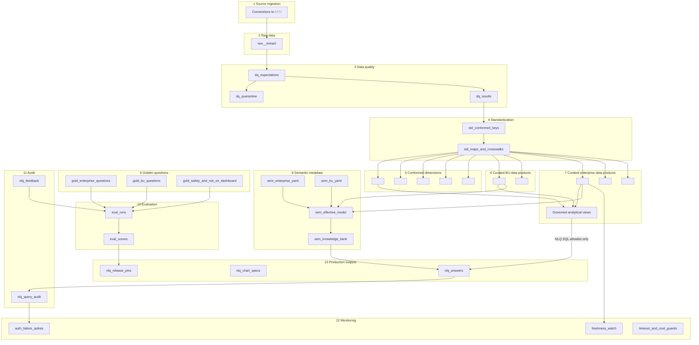

# Dataiku Flow Design (Future Integration) + Local Operating Model

**Company:** `<COMPANY_NAME>`  
**Project key (placeholder):** `<DATAIKU_PROJECT_KEY>`  
**Current phase:** Local development — Flow is a **future** integration blueprint, not an active production deployment.  
**Topology:** Unresolved (DEP-01). Zones below are logical and must exist whether in one DSS project or hub-and-spoke.

NLQ / AI-for-BI executes **only** against curated (and governed analytical) products. Raw, quality, standardization, evaluation, and audit datasets are never in the SQL allowlist.

---

## 1. Local-first vs future Dataiku

| Concern | Local now | Future Dataiku |
|---|---|---|
| Curated data | Local SQL / certified parquet fixtures | Curated Flow datasets |
| Semantic YAML | Git `semantic/` | Managed folder / project library sync |
| NL-to-SQL | Existing local package (`src/nlq` observed; `python/` assumed target) | Same library in DSS code env — **no rewrite** |
| Frontend | Local dashboard + chatbot (design now) | Optional promotion per DEP-02; local remains valid dev UI |
| LLM | Local / configured mesh client | Dataiku LLM Mesh |
| API | Local process / future thin API | Dataiku API service |
| Audit / eval | Local JSONL + fixtures | Audit / evaluation zones + scenarios |

**Hard rule:** Designing Flow zones does not authorize querying raw tables from the local chatbot or dashboard.

---

## 2. Zone map

---

## 3. Zone catalog

| # | Zone | Purpose | Queryable by AI-for-BI? |
|---|---|---|---|
| 1 | Source ingestion | Connect and extract | No |
| 2 | Raw | As-is landing | No |
| 3 | Data quality | Expectations, quarantine, scores | No |
| 4 | Standardization | Conformed keys/maps | No |
| 5 | Conformed dimensions | Shared dims | Yes if curated + allowlisted |
| 6 | Curated BU products | BU facts/dims | Yes if certified |
| 7 | Curated enterprise products + governed views | Enterprise facts/views | Yes if certified |
| 8 | Semantic metadata | YAML, effective model, KB | No as SQL facts |
| 9 | Golden questions | Eval fixtures | No |
| 10 | Evaluation | Scores/gates | No |
| 11 | Audit | Traces/feedback | No |
| 12 | Monitoring | SLA and safety watches | No |
| 13 | Production outputs | Answers, charts, pins | Downstream only |

Certification before `queryable: true`: steward, grain/PK, DQ pass, freshness column, security review, enterprise countersignature for joins into core dims.

---

## 4. Ownership, freshness, lineage, certification

| Metadata | Carried where | Used by |
|---|---|---|
| Data-product owner / steward | Semantic `owner` + DSS dataset metadata | Lineage panel, support |
| Certification status | `status` on products/metrics | Planner allowlist |
| Freshness | `data_freshness` + `<LAST_REFRESHED_AT>` | Result validation, FE indicators |
| DQ requirements | `data_quality` | Gate curated publication |
| Lineage | Flow + semantic data-product refs | Metric lineage panel |
| Semantic version | YAML + release pins | Audit, chatbot metadata |

---

## 5. Recipes and scenarios (logical future slots)

| Recipe / scenario | Role |
|---|---|
| `r_ingest_*` / `r_dq_*` / `r_std_*` / `r_curate_*` | Build curated products |
| `r_sem_validate` | Schema + referential lint |
| `r_sem_materialize` | Merge enterprise + BU YAML |
| `r_kb_reindex` | Retrieval corpus |
| `r_nlq_batch` | Batch ask using **same** library as local |
| `r_eval` | Golden-question evaluation |
| `sc_freshness_watch` / `sc_audit_monitor` / `sc_eval_nightly` | Monitoring |

LLM Mesh (future): pinned per environment; SQL/repair temperature 0; never a security control.

---

## 6. Existing local Python integration into Flow

1. Package the **existing** NL-to-SQL library into the DSS code environment.
2. Do not fork agent logic per BU.
3. Semantic planner emits `semantic_query_plan.v1` then calls existing entrypoints (or a thin adapter).
4. SQL connection is read-only and sees **only** curated allowlisted datasets.
5. Local frontend remains a development interface unless explicitly promoted (DEP-02).

Observed today: implementation lives under `src/nlq/`. Target docs may say `python/nl_to_sql/` — resolve with NLSQL-01 before packaging scripts are written.

---

## 7. Frontend relationship to Flow

| Surface | Phase 1 | Later |
|---|---|---|
| Local dashboard + chatbot | Design only; runs locally against local services | May call API service |
| Native Dataiku webapp | Optional existing asset | Candidate prod UI |
| API service | Not implemented now | Same ask contract as local FE |

Dashboard KPI configuration is stored as config referencing semantic metric ids. It does not define the chatbot allowlist.

---

## 8. BU onboarding in the Flow

1. Add BU curated recipes/products.
2. Add `semantic/business_units/<BU_CODE>.yaml`.
3. Extend materialize inputs by **configuration**.
4. Add golden questions including `not_on_dashboard`, unauthorized, unsupported.
5. Grant SQL connection access only to new curated products.
6. Reindex KB; run evaluation; pin versions.

No `if bu == ...` branches in NL-to-SQL.

---

## 9. What must never be on the NLQ SQL connection

- `raw_*`, quarantine, `std_*` intermediates  
- Evaluation and audit tables  
- Unmanaged uploads  
- Uncertified views over raw  
- Any dataset not in the effective semantic allowlist  

If a user asks to query raw ERP tables, the graph returns **unsupported** — not a Flow exception.

---

## 10. Alignment with this repository

| Existing local asset | Flow design role |
|---|---|
| `src/nlq` NL-to-SQL | Future DSS library; preserve behavior |
| `semantic/` YAML + schema | Zone 8 source of truth |
| `docs/*` Phase 1 design | Control-plane documentation |
| Local audit JSONL | Precursor to Zone 11 |
| Optional `semantic/domains/*` | Certified domain cores after governance — still curated-only |

No Dataiku recipe, API, or frontend implementation is added in this documentation phase.
