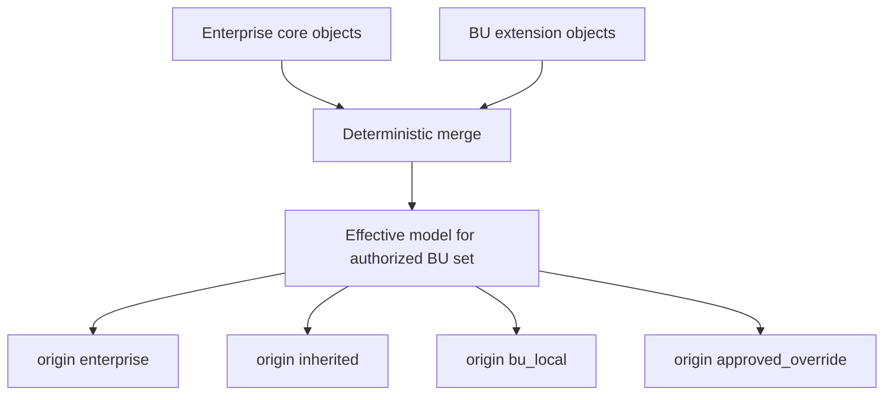
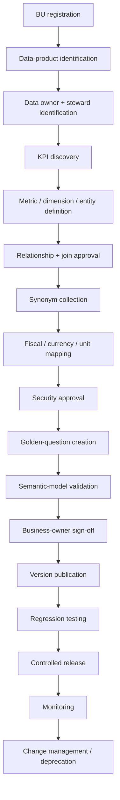

# Two-Level Semantic Layer Design

**Company:** `<COMPANY_NAME>`  
**Status:** Phase 1 design  
**Schema:** [`semantic/schemas/semantic_model.schema.json`](../semantic/schemas/semantic_model.schema.json)  
**Enterprise template:** [`semantic/enterprise/enterprise_semantic_model.yaml`](../semantic/enterprise/enterprise_semantic_model.yaml)  
**BU template:** [`semantic/business_units/example_bu.yaml`](../semantic/business_units/example_bu.yaml)  
**Optional domain specialization:** `semantic/domains/` (certified separately; must not invent formulas in the enterprise template)

The semantic layer is the **business contract** consumed by retrieval, planning, security, dashboard configuration, and the chatbot. Physical SQL is produced later by the **existing NL-to-SQL component** from a **semantic query plan**. The layer is not a pile of table descriptions.

---

## 1. Principles

1. Metrics, dimensions, entities, relationships, joins, calendars, currency/units, and security are first-class objects.
2. Every metric references one or more **approved curated** data products.
3. Every relationship declares join type, condition, cardinality, direction, scope, and validation status.
4. Enterprise and BU definitions are separate documents; merge is deterministic.
5. Inherited ≠ redefined. Overrides require explicit approval (SM-08).
6. Security lives in `security:` and runtime enforcers — never in LLM prompts.
7. Placeholders (`<KPI_NAME>`, `<KPI_FORMULA>`, …) remain unresolved until governance certifies them.
8. Dashboard cards are a **presentation subset** of the semantic metric catalog.

---

## 2. What this layer is / is not

| Is | Is not |
|---|---|
| Versioned metric and grain contracts | Column-comment dump |
| Approved join allowlist | Free-form warehouse exploration |
| RLS / CLS / BU filter policy | Prompt instructions pretending to be ACL |
| Synonym index into objects | Formula source of truth |
| Golden/sample question bindings | Chat transcript memory |
| Input to the semantic query plan | Direct SQL string store |

---

## 3. Level 1 — Enterprise semantic core

Owned by `<ENTERPRISE_SEMANTIC_OWNER_ROLE>` and `<ENTERPRISE_KPI_COUNCIL>`.

Defines organization-wide reusable concepts:

| Family | Purpose | Template examples |
|---|---|---|
| Canonical entities | Shared business objects | `ent.customer`, `ent.product`, `ent.primary_event` |
| Shared dimensions | Conformed attributes | `dim.ent.date`, `dim.ent.business_unit`, `dim.ent.geography` |
| Common date / fiscal framework | Time intelligence | `cal.ent.fiscal` |
| Currency / unit metadata | Comparability | `rule.ent.currency`, `unit.*` |
| Common metric contracts | Naming, grain, additivity, placeholders | `metric.ent.primary_kpi` → `<ENTERPRISE_PRIMARY_KPI>` |
| Data-product contracts | Curated only, owners, PK/grain | `dp.ent.fact_primary` |
| Approved enterprise relationships/joins | NLQ join allowlist | `rel.ent.*` / `join.ent.*` |
| Common synonyms | Retrieval grounding | term → metric/dimension/entity |
| Security-policy references | Roles, RLS, BU filters, CLS | `security.*` |
| Freshness + DQ expectations | Trust signals | `data_freshness`, `data_quality` |
| Ownership / stewardship | Accountability | `owner`, `metric_owner`, `semantic_owner` |
| Versioning / compatibility | Pins | `semantic_versions`, metric `compatibility` |
| Golden-question mappings | Eval fixtures | `golden_questions` |

**Do not invent company-specific KPI formulas in the enterprise template.** Use `<KPI_FORMULA>` and `definition_status: unresolved` until certified.

### Naming conventions

```text
dp.ent.<product>
metric.ent.<metric>
dim.ent.<dimension>
ent.<entity>
rel.ent.<relationship>
join.ent.<join>
role.ent.<role>
rls.ent.<policy>
cal.ent.<calendar>
rule.ent.<currency_rule>
gq.ent.<golden_question>
```

---

## 4. Level 2 — Business Unit semantic extensions

Owned by `<BU_SEMANTIC_OWNER_ROLE>` with enterprise countersignature.

Each BU extension must:

| Requirement | How |
|---|---|
| Reference enterprise core version | `parent_model_id: ent.core` + compatibility pins |
| Inherit shared entities/dimensions | Reference enterprise ids; `origin: inherited` when materializing effective model |
| Define BU-specific metrics | New ids only, e.g. `metric.bu.example.operational_kpi` |
| Define BU synonyms / local dimensions / local products | `bu_local` origin |
| Define approved local relationships/joins | Including joins **to** enterprise entities |
| Declare fiscal/currency/unit applicability | Inherit by default; overrides only if approved |
| Define BU security policies | May tighten; must not weaken SELECT-only / RLS |
| Define sample + golden questions | Including `not_on_dashboard` class |
| Carry ownership / approval metadata | `owner`, statuses, effective dates |
| Avoid redefining enterprise concepts | Unless `origin: approved_override` and SM-08 allows |
| Stay configuration-driven | No hard-coded agent routing per BU |

### Example template

[`semantic/business_units/example_bu.yaml`](../semantic/business_units/example_bu.yaml) uses placeholders `<BU_NAME>`, `<BU_CODE>`, `<BU_OPERATIONAL_KPI>`, `<BU_KPI_FORMULA>`.

---

## 5. Inheritance rules



### Merge policy (v0.2.0 default)

```yaml
allow_metric_override: false
allow_join_override: false
allow_additional_metrics: true
allow_additional_dimensions: true
allow_additional_joins: true
inherit_enterprise_security: true
```

### Algorithm (deterministic, no LLM)

1. Load enterprise core at pinned `semantic_version`.
2. Load each authorized BU extension whose `parent_model_id` matches.
3. Union additional metrics/dimensions/entities/products/joins/synonyms/questions.
4. Reject ID collisions with enterprise ids.
5. Reject BU attempts to replace enterprise `measure.sql_expression` unless `approved_override` and SM-08 = allowed.
6. Intersect security: extra denies win; BU cannot remove enterprise RLS/CLS.
7. Mark enterprise objects copied into the effective view as `origin: inherited` when referenced by BU runtime scope.
8. Pin prompt bundle + runtime compatibility; emit effective-model hash to audit.

### Distinction matrix

| Kind | Meaning | Example |
|---|---|---|
| Enterprise definition | Defined in `ent.core` | `metric.ent.primary_kpi` |
| Inherited definition | Enterprise object available in BU session | same id, `origin: inherited` in effective model |
| Local extension | BU-only object | `metric.bu.example.operational_kpi` |
| Approved override | Rare; replaces enterprise measure under governance | blocked by default |

---

## 6. Object design rules

### Metrics

Resolve **before** SQL:

1. Map question → candidate metric ids via synonyms + intent.
2. Zero matches → clarify or unsupported.
3. Multiple certified matches → clarify (no favorite).
4. `definition_status: unresolved` → clarify that KPI is not certified; **do not compile** `<KPI_FORMULA>`.
5. Emit metric ids + versions into the semantic query plan.

Required: `data_product_ids`, grain, measure placeholders, time dimension, additive type, owners, synonyms.

Non-additive metrics (ratios) must be recomputed at the requested grain.

### Dimensions, entities, relationships, approved joins

- Dimension = presentation/grouping contract over an entity.
- Entity = grain + keys.
- Relationship = business join with **cardinality**, nested join type/condition, **approved_direction**, **data_product_scope**, optional **business_unit_scope**, **security_considerations**, **validation_status**.
- Approved join = physical allowlist row used by SQL validation; must match relationship condition.

Unlisted joins are invalid even if “obvious.”

### Synonyms, calendars, currency, units

Synonyms index terms to objects (and optional `canonical_value` for filter members).  
Fiscal calendar and FX rules are enterprise-owned; BU inherits unless SM-05/KPI-06 authorize local policy.

### Security (independent of LLM)

Includes:

- SELECT-only, single-statement, no Python execution
- Roles, RLS, BU filters
- Sensitive columns + column-level policies + classifications
- Allowlisted databases/schemas
- Aggregation-required columns
- Query cost guards
- `llm_may_bypass: false`

### Freshness, data quality, versions, golden questions

- Freshness per data product (`warn` / `block` / `unresolved`).
- DQ rules (`data_quality`) gate certification, not chatbot hallucination.
- `semantic_versions` append-only.
- `golden_questions` bind eval fixtures to metric ids and expected behavior, including dashboard-independent cases.

---

## 7. Semantic query plan

The plan sits **between** semantic retrieval and the existing NL-to-SQL component.

### Required conceptual fields

- original / rewritten question
- authenticated user context
- authorized BU scope
- resolved intent
- resolved metrics + metric versions
- resolved dimensions + entities
- requested measures
- time range + fiscal period
- filters, ranking, comparison, variance
- grouping + sorting
- currency + unit
- approved data products + approved joins
- RLS predicates + sensitive-column restrictions
- row limit
- expected output grain + result schema
- visualization intent
- ambiguities + clarification_required
- unsupported_reason / unauthorized_reason
- semantic + prompt versions

See JSON Schema `$defs.semantic_query_plan` and the example in [architecture.md](architecture.md) §7.

### Pass-through to existing code in `python/` (or observed `src/nlq/`)

| Step | Owner |
|---|---|
| Build plan JSON (`semantic_query_plan.v1`) | Semantic planner (future thin service) |
| Reject if clarification/unsupported/unauthorized | Orchestrator |
| Call existing NL-to-SQL with plan (or adapter-translated inputs) | Integration boundary |
| Validate SQL against plan allowlists/joins/security | Existing or wrapped validator |
| Execute + return rows | Existing executor |
| Bind answer/chart to rows + plan | Answer/chart services |

**No implementation in this phase.** Discovery NLSQL-03 freezes the exact function signatures.

---

## 8. Retrieval and planning

```text
auth context + question
  -> synonym / metric / entity candidates
  -> authorization filter on metrics and products
  -> neighborhood slice (joins, RLS, freshness, DQ flags)
  -> ambiguity check
  -> SemanticQueryPlan
  -> existing NL-to-SQL
```

Retrieve only the relevant subgraph. Never dump the full enterprise YAML into the prompt.

---

## 9. Dashboard vs chatbot semantic usage

| Concern | Dashboard | Chatbot |
|---|---|---|
| Metric source | Semantic catalog ∩ dashboard config ∩ auth | Semantic catalog ∩ auth |
| Missing card | N/A | Still answerable if certified |
| Filters | Widget + global filters | Plan filters; UI filters are hints only |
| Definitions / lineage | Tooltips + panels | Answer metadata payload |
| Security | Hide unauthorized cards | Refuse unauthorized questions |

---

## 10. BU onboarding and semantic governance



### Checklist

| Step | Owner | Exit criterion |
|---|---|---|
| Register BU code/hierarchy | `<ORGANIZATION_STEWARD_ROLE>` | Stable `<BU_CODE>` |
| Curated products only | `<BU_DATA_PRODUCT_OWNER_ROLE>` | `zone: curated`, stewarded |
| KPI formulas certified or deferred | `<BU_KPI_OWNER_ROLE>` + council | No silent certification |
| YAML from template | `<BU_SEMANTIC_OWNER_ROLE>` | Schema + merge lint pass |
| Joins approved | `<DATA_GOVERNANCE_ROLE>` | relationship + approved_join |
| Security review | `<SECURITY_ARCHITECT_ROLE>` | RLS/CLS/BU filters |
| Golden questions | `<BU_ANALYTICS_LEAD>` | Includes unauthorized/unsupported/not_on_dashboard |
| Sign-off + pin | `<PLATFORM_OWNER_ROLE>` | Version published |
| Regression | `<NLQ_EVAL_OWNER>` | EV-01 gate (when set) |

### Change management

| Change | Bump | Re-eval |
|---|---|---|
| Synonym / sample only | patch | smoke |
| New BU dimension/join | minor | BU golden set |
| Metric formula/grain | minor/major per GOV-03 | full KPI set |
| Security tighten | patch | unauthorized set |
| Security loosen | major | mandatory security review |

New BUs must not require rewriting NL-to-SQL or orchestration code.

---

## 11. Mapping to Dataiku (future) and local now

| Semantic object | Local now | Future Dataiku |
|---|---|---|
| YAML models | Git files under `semantic/` | Managed folder / library sync |
| Effective model | Deterministic merge in process | Materialize recipe + KB index |
| Security | Runtime policy | Same + read-only DSS SQL connection |
| Golden questions | YAML + local eval fixtures | Evaluation zone datasets |
| Curated products | Local parquet/SQL allowlist | Curated Flow zone only |

Raw/quality/standardization datasets must never be on the NLQ connection allowlist.

---

## 12. Consistency rules

1. Every `metric.data_product_ids[]` exists and is curated/queryable.
2. Every dimension/entity product id exists.
3. Every relationship has condition + cardinality (+ direction/scope/validation fields when present).
4. Every approved join references a relationship and matching condition.
5. Enterprise and BU files remain separate; merge is runtime.
6. Security is not defined in prompts.
7. Placeholder enterprise metrics stay unresolved until discovery certifies formulas.
8. Domain specializations under `semantic/domains/` must validate against the same schema and follow governance — they do not replace the placeholder enterprise template for greenfield BUs.
