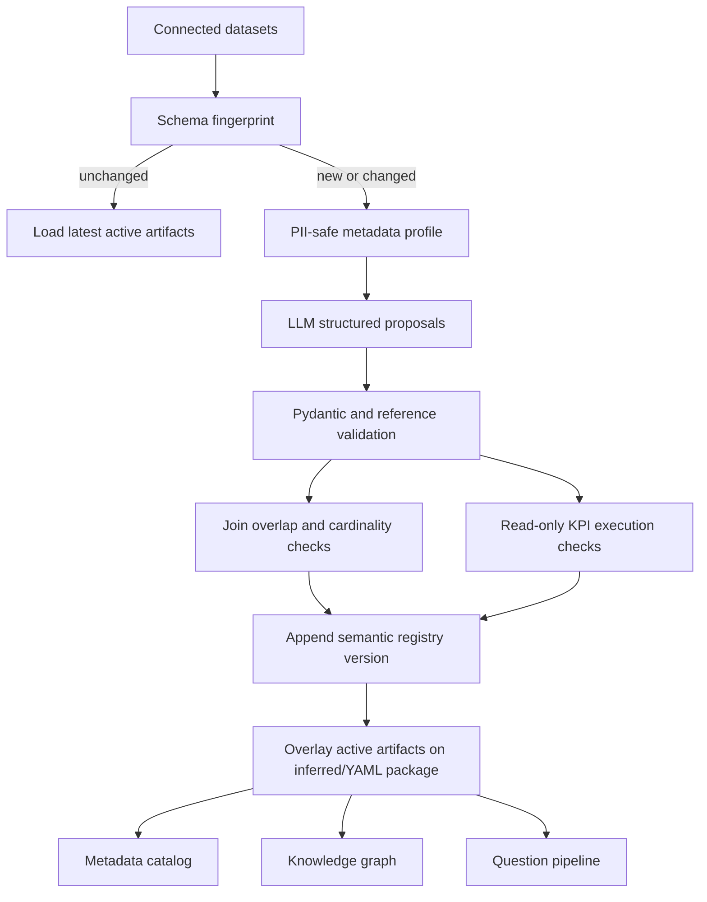

# Architecture

## Components

### Platform-independent core

`lib/python/ai4bi` contains:

- `config` and `logging`: validated settings and structured request logging.
- `data`: source protocols, local files, coercion, restricted-column removal,
  and prompt catalogs.
- `semantic`: Pydantic contracts, YAML baseline loader, versioned registry,
  dynamic onboarding, runtime overlays, and term/metric resolution.
- `metadata`: live column profiling and persistent catalog records.
- `knowledge`: graph, retrieval, document ingestion, history, and stores.
- `llm`: one `LlmClient.complete(system, user)` protocol.
- `sql`: local planner, LLM generator, grounding, policy validation, repair,
  and bounded SQLite execution.
- `answers`, `followups`, and `visualization`: result-grounded output.
- `pipeline`: question, batch, and domain-validation orchestration.

### Dataiku-specific adapter

`lib/python/ai4bi_dataiku` contains the only Dataiku imports:

- `llm_mesh.py`: Dataiku LLM Mesh implementation.
- `variables.py`: project-variable mapping.
- `io.py`: Flow dataset discovery, classification, and tabular serialization.
- `recipes.py`: onboarding, ask, metadata, and evaluation orchestration.

`dataiku/recipes` contains thin scripts that call these functions.

### Local adapter

`local/cli.py` provides equivalent commands over local files and JSON stores.
No Dataiku module is imported.

## Dynamic semantic lifecycle

The fingerprint includes dataset names, row counts, column names, and dtypes.
Artifacts use stable IDs and append-only versions. Latest status controls
runtime use.

## Merge precedence

1. Latest active registry artifact.
2. Curated YAML baseline when no registry replacement exists.
3. Direct schema inference for newly observed datasets/columns.
4. Draft registry artifacts only when explicitly enabled.

This lets an existing curated domain grow dynamically while a completely new
domain starts from its connected frames.

## Validation boundaries

### Privacy

Name-based PII detection runs before model prompting. Curated PII tags also
apply. Restricted fields carry no sample values into the prompt and are
removed before query execution.

### KPI formulas

The LLM returns an aggregate SQLite expression, not an unrestricted statement.
The expression is rejected if it contains statement/control keywords,
comments, or separators. It must reference an observed data product, pass the
SQL policy, execute in the bounded read-only engine, and return a usable value.

### Joins

Both datasets and columns must exist. Activation requires sufficient value
overlap, confidence above the configured threshold, and at least one unique
side. Many-to-many candidates remain drafts. Runtime SQL must still match a
registered active key pair.

## Extension points

No AWS deployment configuration is included. A future adapter can provide:

- `DatasetSource` backed by object storage or a warehouse.
- `LlmClient` backed by another model runtime.
- Registry, metadata, graph, and history stores backed by a database.
- A SQL executor for the target warehouse dialect.

These extensions do not change semantic onboarding or answer generation.
